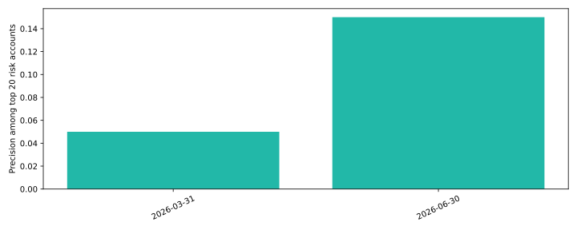

# Customer churn radar

**Which twenty customers should Customer Success review first?**

Observable usage features, forward churn labels, temporal evaluation and a capacity-limited outreach queue. Built for a customer / product analytics portfolio using [Ledgerly](vendor/ledgerly-data/PROVENANCE.md), a fictional B2B SaaS business. All records are synthetic. This is a reproducible portfolio implementation, not a claim of deployed customer impact.



## Try it

Python 3.11 and Git are recommended. Run from this repository’s root.

```bash
python3 -m venv .venv
source .venv/bin/activate
python -m pip install -r requirements.txt
python scripts/bootstrap.py --seed 42
python run.py --data data --out reports
python -m pytest -q
python -m http.server 8000 --directory reports
```

Open http://localhost:8000 for the report. You can inspect the committed [metrics](reports/metrics.json) and CSV reports immediately without installing anything. The HTML report is also committed as [reports/index.html](reports/index.html); download/open locally to view it. GitHub displays its source.

The bootstrap regenerates all synthetic tables locally; source data and databases are ignored by Git. A self-contained, MIT-licensed generator copy is included in `vendor/ledgerly-data`, pinned to commit `339280a4e8ecd67c3d747f5ba560807b41038dc7`. Regeneration uses a deterministic seed within the dependency environment; library upgrades can alter Faker output. Do not substitute real CRM exports into a public commit.

## What to inspect

Inspect features and label separately. Hidden account health is never used. The September queue is an unscored prospective example; March/June cohorts have complete 90-day outcomes.

Outputs go to `reports/`: a standalone HTML dashboard, SVG chart, machine-readable metrics and CSV evidence. Continuous integration runs unit checks, generates fresh seed-42 data and executes the full analysis. The warehouse additionally runs native dbt build/tests. Workflow results are visible in the Actions tab.

## How it works

Completed weekly usage → account-cutoff features → next-90-day churn labels → temporal/account-separated model evaluation → ranked outreach queue.

A deterministic account hash holds out 20% of customers. Training observations end September 2025; tests occur March/June 2026. Only completed weeks contribute usage. Missing history is imputed using training values and missingness indicators.

**Measures:** Average precision versus prevalence, ROC-AUC, Brier score, precision/recall among the twenty highest-risk accounts.

## Seed-42 findings

Held-out cohorts total 245 account-periods. Average precision is about 0.116 versus about 0.049 prevalence; the top-20 queue has mean precision 10%. This is useful ranking evidence, with low absolute precision that still requires operator judgment.

## Business interpretation

Use the outputs to ask whether the decision is supportable, what could go wrong and which additional evidence would change the recommendation. The reports intentionally retain limitations and unsuccessful cases. Performance on generated data measures implementation behavior; it does not establish performance on a real employer’s data.

## Employer alignment

See [role-fit research](docs/role-fit.md) for salary-transparent job examples overlapping $150–200k, skill requirements and location/seniority caveats. See [design and limitations](docs/design.md) for deployment considerations and a short interview walkthrough.

## Scope and limitations

Predicted churn is not a causal uplift score: contacting a customer may not prevent churn. Repeated account observations make row-level confidence intervals inappropriate. No survival model, cost optimization, calibrated intervention benefit or health diagnosis. Future subscription end dates define at-risk eligibility and labels, never features.

## Authorship

Created for Nick Jungmarker’s portfolio with AI-assisted implementation. The commit history records the actual build; no backdated history or employer outcomes are claimed. Before presenting this as evidence of personal proficiency, reproduce it, review the design and be prepared to explain and modify the code. MIT license; the source generator is MIT licensed.

## Related portfolio projects

- [ledgerly-revenue-warehouse](https://github.com/jungmarker/ledgerly-revenue-warehouse)
- [ledgerly-crm-resolution](https://github.com/jungmarker/ledgerly-crm-resolution)
- [ledgerly-sales-forecast](https://github.com/jungmarker/ledgerly-sales-forecast)
- [ledgerly-support-triage](https://github.com/jungmarker/ledgerly-support-triage)
